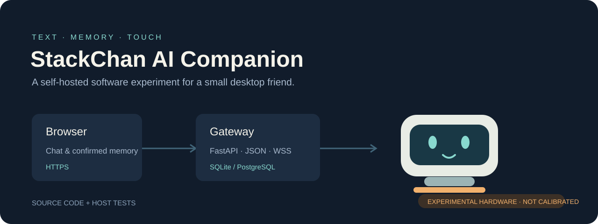
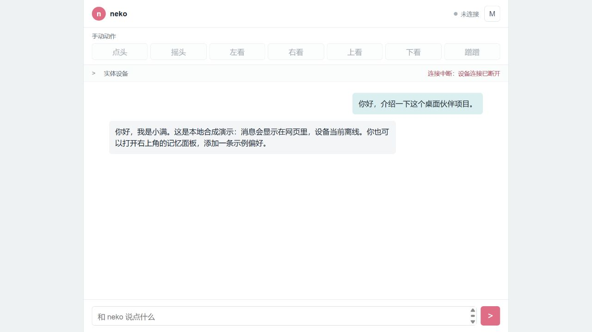
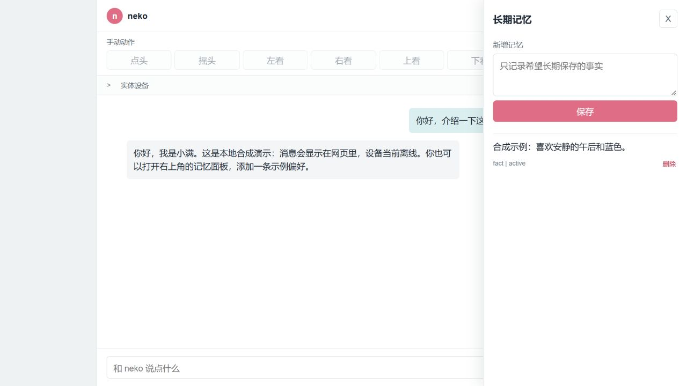

<div align="center">

# StackChan AI Companion

**把文字、记忆和触摸反馈连接到桌面上的小伙伴。**

自托管聊天网关 · 设备协议 · ESP32-S3 定制固件

[English](README.en.md) · [快速开始](docs/getting-started.md) · [架构](docs/architecture.md) · [硬件状态](docs/hardware-status.md)

[](https://github.com/AriaEternity/stackchan-ai-companion/actions/workflows/ci.yml)


[](LICENSE)



</div>

这是基于 M5Stack StackChan K151 的个人开源实验：网页与 AI 交流，网关维护会话和经确认的长期记忆，设备显示文字与表情，并通过受限的命名动作协议接收反馈意图。

**当前发布的是软件源码和实验固件。实体动作的幅度、方向与完成判定仍待实机重新验证；项目处于暂停状态。** 设备已经恢复原厂固件，公开仓库不提供可直接刷写的二进制。下一阶段的文字驱动水平动作仍是计划，参见[硬件状态与已知限制](docs/hardware-status.md)。

## 可以探索什么

| 模块 | 已有实现 |
| --- | --- |
| 网页聊天 | 单用户登录、聊天历史增量同步、设备连接与最近命令状态 |
| 记忆与上下文 | 最近消息、滚动摘要、长期记忆检索；模型提出的记忆先等待用户确认 |
| 模型适配 | DeepSeek 兼容接口、JSON 结构校验、最多三次格式尝试及明确降级 |
| 协议 | v1/v2 JSON 契约、请求头设备认证、心跳、TTL、去重和命令回执 |
| 固件 | 有界 WSS、离线恢复、文字气泡、白名单表情、触摸会话聚合 |
| 动作限制 | 命名动作、服务器默认锁定、固件校准门、队列与频率预算 |
| 验证 | 离线 Python 回归、共享协议样例、C++ 宿主测试、公开范围扫描 |

`completed` 是软件协议回执，不能单独证明实体位移符合预期。当前版本不启用摄像头、麦克风、语音输入或语音输出。上游留下的相关源文件与依赖也不代表这些功能已经接入 Companion。

## 先在电脑上体验

无需设备、API Key 或付费模型调用：

```bash
python -m venv .venv
# Windows: .venv\Scripts\activate
source .venv/bin/activate
python -m pip install -r requirements-dev.txt
python tools/demo.py
```

打开 `http://127.0.0.1:8787`，使用演示密码 `local-demo`。演示仅监听回环地址，使用确定性假模型和临时数据库；不连接实体设备。退出时数据库由临时目录回收。



<details>
<summary>查看合成记忆面板</summary>



</details>

正式自托管需要自行设置密码、签名密钥、设备令牌、模型 Key 和 HTTPS。详见[运行说明](docs/getting-started.md)与[部署说明](docs/deployment.md)。

## 源码地图

```text
server/          FastAPI 网关、SQLite/PostgreSQL 存储、网页、离线测试
firmware/        基于 M5Stack 的 ESP-IDF 工程、Companion 模块和 C++ 测试
protocol/        v1/v2 设备契约与共享 JSON 样例
examples/        新建的合成角色示例
deploy/          通用 Compose、Nginx 和环境变量模板
tools/           本地演示、依赖下载、配网辅助和公开范围检查
docs/            架构、部署、固件构建与硬件状态
```

## 验证

```bash
python -m unittest discover -s server -p "test_*.py" -v
python -m unittest discover -s tools -p "test_*.py" -v
python tools/check_public.py
cmake -S firmware/tests -B .cache/host-tests \
  -DPROTOCOL_EXAMPLES_DIR="$PWD/protocol/examples" \
  -DPROTOCOL_V2_EXAMPLES_DIR="$PWD/protocol/examples-v2"
cmake --build .cache/host-tests
ctest --test-dir .cache/host-tests --output-on-failure
```

C++ 测试使用 `assert`，请使用默认配置或 Debug 构建，避免用 `NDEBUG` 禁用断言。CI 在干净检出上运行这些测试。ESP-IDF 构建方法另见[固件文档](docs/firmware.md)，宿主测试通过不等于实体动作验收通过。

## 来源与开源范围

定制固件基于 [M5Stack/StackChan](https://github.com/m5stack/StackChan/tree/b72b3ede38b32d54f0b6ba51c62cfcef2ec3ae1e) 的公开源码 `b72b3ed`，其版本号为 `1.4.3`。本仓库是独立的整理副本；服务端、协议、Companion 模块与测试构成项目的扩展部分。

仓库只包含源码、通用模板和合成样例，不包含实际使用者的角色原文、记忆、聊天、数据库、设备 NVS、整机备份、密钥或生产部署资料。

自有代码采用 [MIT](LICENSE)。M5Stack、FTServo、Bosch、Montserrat 等上游内容保留原始版权与许可证，下载的第三方依赖适用各自条款，详见[第三方说明](THIRD-PARTY-NOTICES.md)。

相关项目：[葵栖](https://github.com/AriaEternity/kuinest) · [直播☆双子](https://github.com/AriaEternity/live-twin-community)
