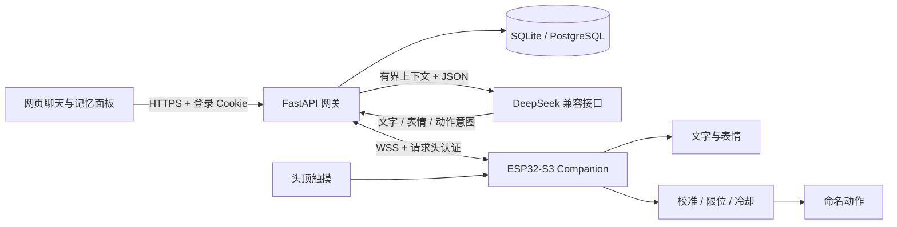

# 架构与数据流

## 服务端

`production_app.py` 提供单用户登录、聊天、记忆管理、消息增量查询和设备 WebSocket。`service_store.py` 使用 SQLAlchemy，可选 SQLite/PostgreSQL；`memory_store.py` 服务于无认证离线原型。

最近 20 条消息、最多 80 条较早消息生成的有界滚动摘要，以及检索到的确认记忆共同进入上下文。摘要在本地生成。模型的记忆建议以 `candidate` 保存，由用户在记忆面板确认后参与正常长期检索。

触摸通过开始、可选划动和结束形成会话，使用冷却、预算与超时控制模型调用。模型的触摸输出本身不能直接指定实体动作或创建长期记忆。服务器另有显式动作策略，默认锁定。

## 固件

`firmware/main/companion/` 包含协议解析、有界 WebSocket、连接状态、队列、动作调度、触摸和配网模块。网络回调只校验和排队，显示与动作操作由应用线程执行。

v1 为冻结的兼容契约，v2 增加最多 512 UTF-8 字节的文字显示。命令有 TTL、去重、队列长度与频率预算；断线会清理待处理内容，避免重连后重放旧动作。

`accepted`、`completed`、`rejected`、`expired`、`busy` 是协议终态/阶段状态，不是机械质量验收。历史实测出现过完成回执与可见动作不符，后续需要从底层定位。

## 隐私边界

示例角色与测试消息是合成资料。正式使用者的角色、数据库、模型 Key、设备令牌与 NVS 只属于其部署环境。服务器持久化聊天和确认记忆；最近命令观测仅在内存中保留 32 条，过滤掉任意载荷与文字内容。

Redis 在 Compose 中为历史扩展预留，当前同步聊天链路不依赖任务队列。
